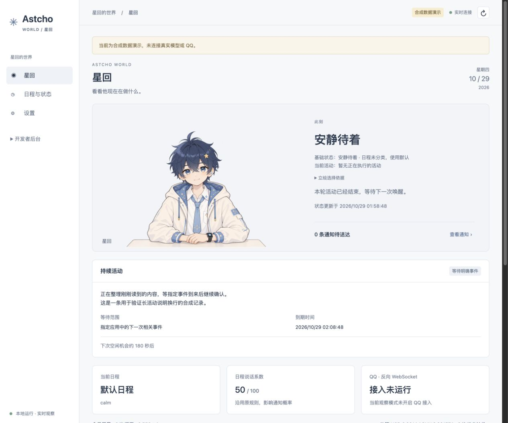

# Astcho World

给星回搭一个可以自己选择的生活环境。

最早的星回生活在 QQ 里，收到消息后判断要不要回复。我想让他的世界再大一点：可以自己打开群聊，也可以去 B 站找点想看的东西、搜索网页、记下事情，或者什么也不做。

这个项目负责提供应用、工具、通知和记录。至于要不要看、要不要说话、接下来做什么，交给星回自己判断。后续想加新的应用，也应该能单独接进来，不用重写一遍主体。

目前还在自用和迭代，离成熟的通用框架有距离。能跑起来，也有不少地方需要继续试。



*截图使用合成数据。*

## 现在能做什么

- **QQ**：通过 NapCat 反向 WebSocket 收发消息。通知只带来源和触发的单条消息，他可以忽略，也可以打开上下文。支持群免打扰、未读数、查记录、看图和主动回复。
- **B 站**：浏览推荐、搜索、读取视频资料和字幕，结合画面了解内容；可以点赞、收藏、评论，也能把普通视频链接分享到 QQ。评论和分享都由主体选择。
- **网页**：使用 DSH 的 `web_search` 和 `web_fetch` 搜索、按链接读取网页。还没有能点击、填表、处理登录态的浏览器。
- **笔记和资料**：Notes 保存自己的笔记，Library 按需查阅配置好的资料目录。
- **提醒和 Skill**：使用 DSH 原生的持久提醒与 Skill 加载，只扫描明确指定的 Skill 目录。
- **Web 页面**：查看日程、当前活动、通知、完整模型输入、用量和缓存命中率，管理 B 站扫码登录及立绘。

管理员私聊可以让他使用已有工具做事。普通私聊沿用原聊天链路，不开放环境工具。主体的普通文字输出不会自动发到 QQ，发消息需要明确调用发送工具。

## 先试一下

需要 Python 3.11+。目前主要在 macOS 上使用和验证；运行锁依赖 `fcntl`，Windows 暂不支持直接运行。

```bash
git clone https://github.com/maliang233/astcho-world.git
cd astcho-world
python3 -m venv .venv
source .venv/bin/activate
python -m pip install -e '.[host,legacy,agent,dev]'
```

默认主体使用 `deepseek-harness-sdk==0.2.1rc2`。SDK 负责模型与工具循环、会话等能力，World 通过插件接上自己的应用。这个版本仍是预发布版，升级前需要重新验证。

不填模型密钥也能先看演示：

```bash
astcho-world demo
astcho-world web --demo --port 8092
```

第一条在终端运行合成消息流程，第二条打开演示 Web 服务。演示页面地址为 `http://127.0.0.1:8092`，终端会输出带登录 token 的链接；都不会调用真实模型或发送 QQ 消息。

## 接上自己的 QQ

准备好 NapCat，再复制一份本地配置：

```bash
mkdir -p config
cp .env.example .env
cp examples/apps.local.example.json config/apps.local.json
cp examples/profile.json config/profile.local.json
cp examples/schedule.json config/schedule.local.json
```

编辑这些文件：

- `.env`：填写主体模型、聊天模型和密钥，把 `ASTCHO_ADMINS` 改成你的 QQ 号。图片理解需要支持视觉的模型，搜索需要另填 `DEEPSEEK_API_KEY`。
- `.env` 中的 `ASTCHO_ALLOWED_GROUPS`，以及 `config/apps.local.json` 的 QQ `allowed_groups`：都把示例群号 `10003` 换成你允许使用的群。
- `config/profile.local.json`：填写你自己的人格资料，示例只放了名字和一句自我介绍。
- `config/schedule.local.json`：填写日程和 `talk_value`。示例全天为 50；值小于等于 5 时，自适应周期唤醒停止。

这份接入示例已启用 QQ 发送。准备好配置后运行：

```bash
astcho-world serve
```

NapCat 添加 **Universal 反向 WebSocket**，地址为：

```text
ws://127.0.0.1:8091/onebot/v11/ws
```

收事件和调用发送 API 共用这条连接。账号从握手中自动识别，不需要再配 HTTP POST。若设置了 `ONEBOT_ACCESS_TOKEN`，NapCat 填相同值。NapCat 在 Docker 里时，要使用容器能访问的主机地址，并相应调整 `.env` 的 `ASTCHO_WORLD_HOST`。

服务默认监听本机，终端会输出 Web 登录链接。Apple Silicon Mac 也可以双击仓库里的 `启动星回.command`；它使用本目录的 `.venv` 和配置。`停止星回.command`、`重启星回.command` 用于管理这个启动器创建的实例。

只想接收事件、不启动主体模型时，可用 `astcho-world serve --read-only`。同一个 QQ 账号不要同时运行两个自动回复实例。

记忆和表达学习在示例中关闭，可以按需要自行开启。详细接入与私聊分流见 [运行说明](docs/PRIVATE_ROUTING.md)。

## B 站是可选的

B 站应用使用独立 Python 环境：

```bash
python3 -m venv var/runtimes/bilibili
var/runtimes/bilibili/bin/python -m pip install -r requirements/bilibili.lock.txt
var/runtimes/bilibili/bin/python -m pip install -e . --no-deps
```

然后把 `.env` 的 `ASTCHO_WORLD_BILIBILI` 设为 `1`，重启服务，在 Web 的 Bilibili 应用页扫码登录。凭证保存在本地，不通过聊天传 Cookie。

视频理解会参考实际取得的资料、字幕和画面，并不等于完整看过视频。没有字幕时会如实返回，语音转写目前没有接入。实现范围见 [活动与 B 站](docs/ACTIVITIES_IMPLEMENTATION.md)，登录问题见 [扫码登录](docs/BILIBILI_LOGIN.md)。

## 唤醒、上下文和费用

示例配置开启了周期唤醒，按日程约每 2～10 分钟给一次空闲机会；`talk_value=75` 时为 150 秒。@、引用、管理员私聊和到期提醒仍走事件唤醒，不必等周期。

可以把 `ASTCHO_WORLD_ADAPTIVE_WAKE` 设为 `0` 关闭周期，或用 `ASTCHO_WORLD_WAKE_MIN_SECONDS` / `ASTCHO_WORLD_WAKE_MAX_SECONDS` 调整范围。修改后重启。打开群聊不要求回复，看到通知也不要求处理。

每次模型被唤醒，即使最后决定什么都不做，也有调用开销。Web 用量页会记录提供商报告的 token、缓存命中和按配置价格估算的费用。主体、图片理解、搜索和长上下文压缩可能分别计费。

活动结束后，完整经历留在本地，近期只保留有限条索引，默认 10 条。索引由程序根据动作和回执生成，不再另调用模型写摘要；主体也可以在结束时自愿留一句话。需要细节时，他可以按活动编号查回原文。当前不增加总输入 token 预算，也不在压缩失败后强行裁掉历史。

## 应用怎么加

每个 App 有自己的工具声明、子进程和数据目录，通过统一 JSONL 协议与内核通信。新增应用时，实现 `dispatch`、写 Manifest，再加入应用配置即可；使用说明可以另放进 Skill。

应用间不直接读写彼此的内部状态。要把 B 站视频分享到 QQ，主体先取得视频链接，再调用 QQ 的分享工具。子进程和数据目录的分离用于故障与状态管理，不是操作系统安全沙箱，安装 App 时仍需信任其代码。

协议和扩展方式见 [APP_SPEC](docs/APP_SPEC.md)，可以从 [Notes](src/astcho_world/apps/notes.py) 和 [Library](src/astcho_world/apps/library.py) 看起。

```text
src/astcho_world/    环境、运行器、App 和 Web
src/astcho/          保留的原聊天实现
examples/           配置、Manifest、Skill 和资料示例
requirements/       独立应用的依赖锁
var/                本地运行数据，不提交
```

原聊天源码与测试按哈希保留。群聊现在由同一个主体组织回复，场景要求和发送处理复用原实现；普通私聊保留原路径。改动边界见 [群聊接入](docs/QQ_SUBJECT_REPLY.md) 和 [兼容性记录](docs/COMPATIBILITY.md)。

## 开发与检查

```bash
python -m pytest
python -m astcho_world check-baseline
node --test tests/dsh/*.test.cjs tests/web/*.test.cjs
```

测试包含真实安装的 DSH SDK、本地合成模型和测试反向 WS，不需要真实 API 密钥。原版有一项已知的 Planner 文案断言失败，源码和测试都保留，见 [验证记录](docs/TEST_REPORT.md)。

`.env`、`config/*.local.*`、聊天记录、账号凭证、数据库和备份留在本地。仓库不包含实际使用的人格、日程或聊天数据。

## 来源

项目从 [Astcho](https://github.com/maliang233/astcho-github) 的本地版本继续开发，主体运行使用 [DeepSeek Harness](https://github.com/deepseek-ai/deepseek-harness) 的 Python SDK。B 站只读浏览部分参考了 `c1overzz/dsh-bili-scroll`，保留了来源代码和 [MIT 声明](src/astcho_world/vendor/BILI_LICENSE.txt)。

代码使用 [MIT License](LICENSE)。
