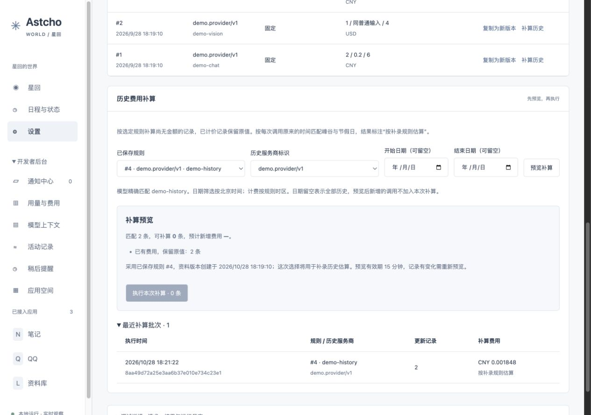
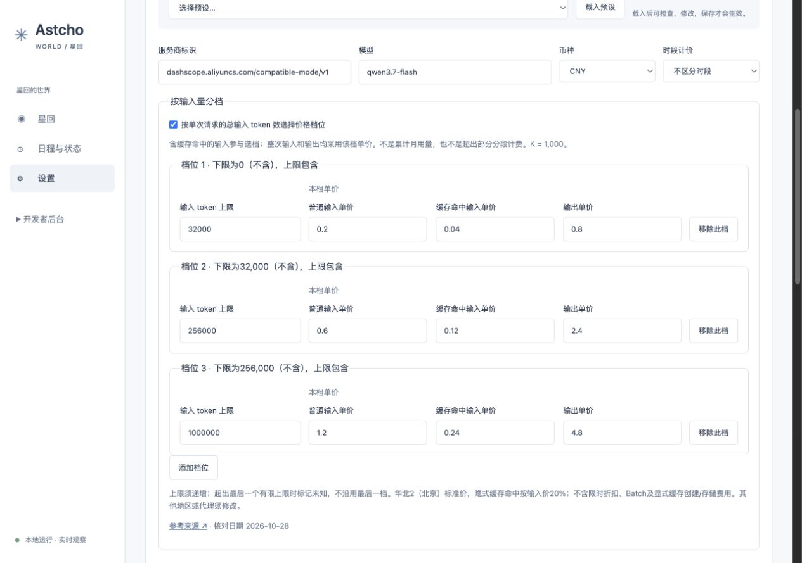

# 用量与费用

开发者后台 → 用量与费用，或点击首页“今日用量”。统计日期采用 Asia/Shanghai。

## 页面

- 今日、本月、最近 7/30 天和自定义日期（最多 366 天）。按服务商、模型、用途、应用筛选。 服务商等筛选选择后点击“应用筛选”提交；未提交条件在实时更新及汇总维度切换时保留，统计仍按已应用条件刷新。筛选控件不会随统计结果刷新而重建。
- 已记录调用数、输入、输出、缓存命中、按币种拆开的估算费用。缺失用量及尚未计价的数量单独提示。
- 每日趋势、按用途/模型/服务商/应用/活动汇总、按实际发生时间排序的调用明细和分页。聚合始终覆盖完整筛选范围，与明细分页无关。
- 点击日期、分类缩小范围；点击调用可看计价依据、原始用量和快照。环境调用能关联记录的实际上下文；活动 ID 可跳到活动用量及日志轨迹。
- 单价配置在独立的“设置 → 计费”页。输入/输出单价为必填，缓存命中输入单价可留空（等同普通输入）。币种分别累计，不自动换汇。

## 费用口径

`费用 = ((总输入 - 缓存命中) × 普通输入单价 + 缓存命中 × 缓存单价 + 输出 × 输出单价) / 1,000,000`

单价按服务商标识与模型名称精确匹配。标识优先为去除凭证/查询串后的 API 主机及路径。DSH 旧记录若仅有适配器名则保留原标识，不猜其历史服务商。保存生成新版本，只用于之后发起的调用；运行中的请求也继续采用发起时的版本。历史未计价记录不会因为新增单价而自动补算。

- `estimated`：按该请求的用量及已快照的单价版本计算。本地估算，非服务商结算账单。
- `unpriced`：有完整输入输出计数，但请求发起时没有匹配单价。
- `unknown_usage`：提供商未返回完整用量，不等于零 token 或零费用。
- `unknown_cache`：缓存单价与普通输入不同，但缓存计数未知，无法准确计算费用。
- 明确配置为零的单价可得到真实的零估算，与未配置不同。

使用 Decimal 计价，保存原始小数；前端最多显示 6 位小数。输出中的 reasoning 仅作为明细，绝不重复累加。当前版本将缓存写入量按普通输入计价，不支持独立的缓存写入/存储/多模态收费规则。输入长度分档见下文。

DSH SDK 的 `inputTokens` 为非缓存输入，`cacheReadTokens`/`cacheWriteTokens` 是附加计数；统一口径的总输入包含这些部分。OpenAI 兼容接口的 `prompt_tokens` 已包含缓存，其缓存量仅为子集。缺失缓存字段默认保持未知；唯一可核实的例外是 DSH 省略零值字段，但同时报告完整总量：当 `totalTokens = inputTokens + outputTokens + 已知cacheWriteTokens` 且相关字段合法时，未提供的 `cacheReadTokens` 可以确认是 0。没有总量、有未解释余量、显式缓存字段非法或调用中断未报用量时，不补 0。

## 数据接入与保护

`usage_calls` 是统一账本，`usage_rates` 是追加保存的单价版本。DSH 以 request_id 将请求、usage、结束和上下文/活动关联。native 环境运行器也记录相同账本；统计不读写模型输入，不添加预算、裁剪或停止行为。

原聊天代码 `src/astcho` 不修改。在 World 的 Conversation 适配层被动包装已有客户端的 `create`，原参数原样转发，原响应对象与异常原样返回。原有 usage_callback 继续工作。schema 名称仅用于标注已有 JSON 调用用途；不能修改其 schema 或 prompts。公开客户端调用中发生的重试分别记录；SDK 内部未暴露用量的 HTTP 重试不推算。

应用可使用 `astcho_world.usage_capture.UsageReporter(data_dir)` 写入自己的 `usage-spool.sqlite3`。报告形式：

```python
reporter.emit({"event": "start", "request_id": "stable-unique-id", "created": timestamp,
               "provider": "api.example/v1", "model": "model-name", "purpose": "vision",
               "operation_id": operation_id})
reporter.emit({"event": "end", "request_id": "stable-unique-id", "status": "succeeded",
               "duration_ms": 123,
               "usage": {"prompt_tokens": 100, "completion_tokens": 10,
                         "prompt_tokens_details": {"cached_tokens": 80}}})
```

目前此插件报告协议针对 token 计费；次数、时长计费后续扩展。报告不含提示词/聊天内容或 API key。主服务每两秒只读导入各应用自己的 spool，按请求 ID 和导入游标去重。保留 spool 及其 installed 元数据；备份时与应用数据一起保存。

首次导入可读新环境各 app/cognition/astcho.sqlite3 中已有 llm_usage；仅导入安装采集器之前的历史，避免原回调与新采集重复计数。历史用途、服务商、缓存信息缺失时保留未知；不沿用原简易 estimated_cost 冒充已核算费用。不会读取或迁移原机器人目录的数据。

GET /api/usage 是只读查询。POST /api/usage/rates 需要同一管理员会话，并拒绝跨站来源；仅写本地计价配置，不调用任何应用工具或影响星回所知的信息。

`web --demo` 使用临时目录和明确的合成单价/用量，可用于页面预览；正式数据不写入合成记录。

## 分时计价与独立设置页（2026-10-28）

配置入口迁移为“设置 → 计费”，统计页只保留分析、筛选和“前往计费设置”入口。设置按计费、模型与连接、应用、界面与运行分类。计费支持在线编辑；其余分类按明确字段展示当前配置与来源，模型/接入仍通过 .env 或启动参数修改后重启，不暴露密钥。应用分类链接到各应用的能力和记录。

### 规则与版本

保留原固定单价，新增 time_of_use 规则。每个版本包括时区、高峰生效星期与时间窗口、高峰和空闲各三项单价、可选节假日日历及其来源/版本/已核对年份。窗口左闭右开，支持跨午夜（星期按开始日计算），跨周的重叠窗口也会拒绝。未命中任何高峰窗口时使用空闲价格。日历空闲日期覆盖周规则。

请求发起时保存完整 pricing_snapshot，冻结时段、价格、日历、匹配原因和本地时间；结算时不重新根据当前时间或新版本选择单价。峰谷边界采用本地请求发起时间估算，官方价格页没有明确跨时段请求的起止判定，服务商实际扣费以账单为准。

`unknown_schedule` 表示启用的日历没有覆盖请求年份；不推断该年节假日或套用其他年份。历史固定单价调用与未计价调用保持原值，新增数据库列不会追溯重算。查询时可按 fixed、peak、off_peak、unknown、unpriced 筛选，并分别汇总各时段。

### DeepSeek 预设

预设核对日期：2026-10-28。来源：[DeepSeek 官方模型与价格](https://api-docs.deepseek.com/zh-cn/quick_start/pricing/)。按该日规则，北京时间周一至周五 09:00–12:00、14:00–18:00 为高峰，周末及中国节假日为空闲。预设将国务院公布的放假日期作为节假日日历进行本地估算，调休周末仍按周末空闲规则处理。

CNY / 每百万 token，顺序为普通输入 / 缓存命中输入 / 输出：

| 模型 | 空闲 | 高峰 |
| --- | --- | --- |
| deepseek-flash | 1 / 0.02 / 4 | 2 / 0.04 / 8 |
| deepseek-v4-pro | 4.5 / 0.15 / 13.5 | 9 / 0.30 / 27 |

日历版本 cn-public-holidays-2026-gbfmd-2025-7，来源：[国务院办公厅 2026 年放假安排](https://www.gov.cn/zhengce/content/202511/content_7047090.htm)。仅包含 2026 年；下一年需要导入或填写核对后的日历并保存新版本。规则允许在设置页自定义，避免将某一厂商或年份写死到决策循环中。

选择预设仅载入草稿，保存才生效。正式环境不会自动套用演示价，也不会自动修改已保存规则。服务商标识必须与实际调用匹配，代理服务应按其自身报价配置，不能因模型名相同自动套官方价格。

### API

- GET /api/settings：分类配置、计费预设、版本历史和可选服务商/模型；只读、需会话认证、使用安全字段白名单。
- POST /api/settings/rates：新增固定或分时规则版本，沿用同源验证；原 /api/usage/rates 保持兼容。
- GET /api/usage?tariff=peak：统计整段筛选范围的高峰调用；其他计费时段同理。

设置草稿不被实时统计刷新覆盖，分类切换保留草稿。源数据中的密钥、认证请求和任意配置字典不会传给页面。

## 历史费用补算（2026-10-28）

新增规则仍不自动修改历史费用。需要补录时，在“设置 → 计费 → 历史费用补算”选择已保存规则、历史服务商标识及可选日期范围，点击“预览补算”，核对数量、金额与跳过原因后再执行。版本表中的“补算历史”和保存后的快捷入口会选中对应版本。

- 模型名称精确匹配；默认匹配规则的服务商标识。旧记录若使用不同标识，可以显式选择其历史标识，页面会提示价格适用关系，不自动猜测或更改原服务商。
- 使用原调用时间匹配规则时区、峰谷与节假日。日期范围按北京时间筛选，结束日期包含全天。后补规则的版本时间不会阻止显式补录，但不代表该规则就是当时的官方价格。
- 只补算尚无金额且用量充分的已结束记录。已有金额（包括零费用）保持原值。输入/输出缺失、差别计价所需缓存量缺失、日历年份未覆盖、仍在运行的调用分别显示跳过原因，不填零、不推测。
- 预览不写数据库；锁定当时的历史范围，后续新增或导入的记录不混入本批次。预览有效期 15 分钟，相关记录或规则变化时必须重新预览。
- 执行与审计同一事务提交，失败整批回滚。相同预览重复执行返回原结果，不重复计费。补算后的统计按原调用日期归属。
- 结果及调用详情标注“按补录规则估算”，保留规则完整快照、版本、补录时间、批次、原服务商和规则服务商。`usage_backfill_batches` 保存批次范围与汇总，`usage_backfill_items` 保存每条记录计价字段修改前后的审计数据；设置页展示最近 10 个批次。

新增 API 均需管理员会话及同源校验：

- `POST /api/settings/usage-backfill/preview`：`rate_id`、可选 `provider`、`start`、`end`；返回完整范围汇总、最多 50 条候选明细及签名预览凭证。
- `POST /api/settings/usage-backfill/execute`：只接受 `preview_token`，不能跳过预览直接传规则执行。过期或相关数据变化返回 409。
- `GET /api/settings` 的 `billing.backfills` 返回最近批次。此功能只写本地计费记录，不调用模型或应用工具。

演示界面（合成数据，已补算两条后再次预览会跳过）：



## 按单次输入长度分档（2026-10-28）

设置 → 计费勾选“按输入量分档”，按顺序填写各档输入上限和普通输入、缓存命中、输出单价。时段计价独立配置：可以不区分时段，也可以叠加峰谷，在每档分别填写高峰与空闲单价。

按提供商返回的总输入（含缓存命中）选一档，整次输入和输出均使用该档单价，不是累进分段，也不按月累计。上限包含、下限不含；K = 1,000，M = 1,000,000。32,000 属于第一档，32,001 切换至第二档。最后一档可显式留空表示不限；超出有限最大档显示 `unknown_tier`，不猜价。

规则表新增可空 `tiers` JSON 列；旧记录、价格版本与费用保留原值。请求开始冻结全部档位与时段规则，用量返回后从该快照选档。计价快照保留实际总输入、上下界、单价、选档依据和整次计价方式。调用详情及历史补算预览展示档位，补算沿用同一计算器，仍不覆盖已有金额。

`POST /api/settings/rates` 可同时提供原 `scheme` 和 `tiers`：

```json
{"basis":"input_tokens","method":"whole_request","rows":[
  {"up_to":32000,"input_price":"1","cached_price":"0.2","output_price":"4"},
  {"up_to":null,"input_price":"2","cached_price":"0.4","output_price":"8"}
]}
```

上例为 `tiers` 字段的合成规则。叠加分时规则时，各行另需 `peak` 价格对象；行本身三项单价作为空闲价格。后端拒绝重复/倒序/小数上限、非末档无限上限、缺失高峰价及未支持的计价方法。

官方预设新增 Qwen3.7 Flash、Plus 的华北2（北京）标准价与隐式缓存价格，核对日期 2026-10-28。不含限时优惠、Batch、显式缓存创建和存储；其他地区、显式缓存或代理需按实际报价修改，载入不会自动保存。价格与分档规则依据[百炼官方价格](https://help.aliyun.com/zh/model-studio/model-pricing)，缓存依据[官方上下文缓存说明](https://help.aliyun.com/zh/model-studio/context-cache)。Plus 的限时折扣不在标准价预设中。




## DSH 零缓存显示修复（2026-10-29）

DSH pi-ai 适配器省略值为0的缓存桶；World按上述完整总量等式恢复其SDK层语义，不声称取得未保存的提供商原始响应。

新调用在记账时识别。启动时会幂等修正已有DSH记录中可核实的零缓存投影，并写入 `usage_normalization_repairs`，保留版本、原因和修正前后字段。原始usage、事件、请求、状态、输入/输出量、历史单价版本与计价快照保持不变。仅对原 `unknown_cache` 的记录按已有快照恢复估算费用；已结算金额不改，未配置单价的不自动套用新价格，真正未知的缓存仍未知。这是已有用量的兼容修正，与“保存新单价后显式补算旧请求”分开处理。

SDK来源：[pi-ai用量映射](https://github.com/deepseek-ai/deepseek-harness/blob/master/packages/llm/llm-pi-ai/src/stream.ts)、[DSH互斥token桶](https://github.com/deepseek-ai/deepseek-harness/blob/master/packages/llm/llm/src/types.ts)。
