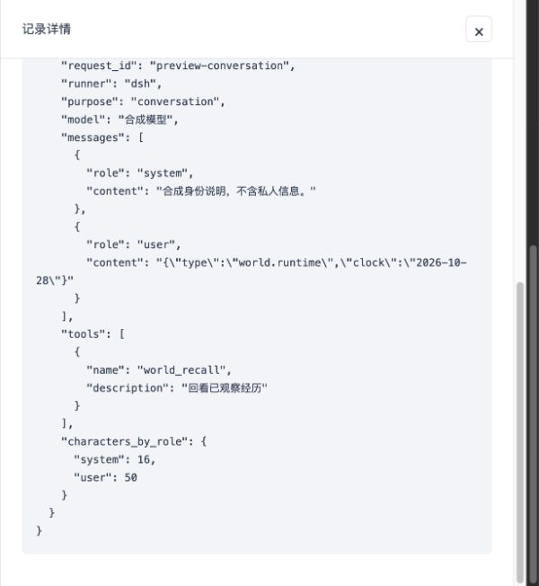

# Web 观察台与 macOS 启动器

## 启动

macOS 双击 `~/Applications/Astcho World.app`，或仓库根目录的 `启动星回.command`。
启动器使用本项目 `.venv`，自动打开浏览器；已正式运行时仅重新打开网页，不启动第二个实例。自己的旧观察服务会被关闭并切换为正式运行。

- 配置完整时运行 `serve`：星回主体与 Web 在同一个服务进程中运行。
- 缺少模型或 `ASTCHO_ADMINS` 时明确报错，不再降级到观察模式。
- 补齐 `.env` 后双击 `重启星回.command`。双击 `停止星回.command` 停止由此启动器创建的服务。
- 网页关闭后服务继续运行。默认访问 `127.0.0.1:8091`；独立 `web` 仅绑定本机，`serve` 的监听地址按 CLI/环境配置。
- 启动器日志在 `var/launcher/server.log`，访问令牌保存在权限为 0600 的 `var/launcher/web-token`。
- 启动器运行 `serve --qq-transport reverse_ws --runner dsh`，账号连接后自动识别。按本次授权，本地 QQ 发送开关已开启，NapCat Docker 的反向地址已设为 `ws://host.docker.internal:8091/onebot/v11/ws`。详见 [正式运行与私聊](PRIVATE_ROUTING.md)。

重新安装启动器（例如移动项目目录后）：

```bash
.venv/bin/python tools/install_mac_launcher.py
```

手工运行：

```bash
.venv/bin/python -m pip install -e '.[host,agent,legacy]' httpx
# 只使用 Web 时，可以仅安装 host 可选依赖。
astcho-world serve
# 只读，独占本环境目录，不与另一个 serve 同时运行：
astcho-world web
# 独立临时目录中的合成演示；无需 .env、模型或 QQ：
astcho-world web --demo --port 8092
```

命令会打印带一次性页面登录入口的本地 URL（访问令牌本身在服务重启前有效）。
令牌放在 URL fragment，不进入 HTTP URL/访问日志；页面登录后清除 fragment，使用 HttpOnly、SameSite=Strict cookie。
可通过 `ASTCHO_WORLD_WEB_TOKEN` 固定 Web 令牌，不要把它提交到版本控制。

## 已实现

- 状态总览：等待模型、执行工具、空闲、异常、步数耗尽、只读观察模式。
- 日程与状态：原日程时段、当前说话系数、特殊日期与临时覆盖、QQ 连接、原能力接入情况，以及实际运行时上报的情绪与记忆数量。
- 通知中心：最近 100 条已持久化通知，区分待送达、已送达和已忽略。
- 活动时间线：实时刷新、暂停、关键词/应用筛选、分页、单次活动回溯、详情抽屉。
- 应用目录：自动展示注册应用、进程状态、工具说明和参数 Schema。
- 自设提醒：最近 100 条提醒与触发状态。
- 声明式 App 视图：表格和卡片，数据来自环境已保存的通知、操作、工具观察。
- 本地鉴权、只读 API、未知事件通用展示、结构化敏感字段遮蔽。

页面只读取环境记录，不调用 `Store.notifications()`、模型工具或 App 的读取操作。
浏览网页不改变星回的通知送达、QQ 已读位置、观察记录或模型上下文。
独立 `web` 命令仍会作为环境所有者打开 Store，执行已有的中断操作恢复；它不是对正在运行的其他内核的外部数据库连接。

## App 扩展协议

现有 Manifest 可不添加任何字段，Web 会自动提供通用应用页。
需要专属记录布局时，添加可选 `dashboard`：

```json
{
  "dashboard": {
    "version": 1,
    "name": "我的日记",
    "icon": "J",
    "views": [{
      "id": "saved",
      "title": "保存记录",
      "source": "operations",
      "component": "table",
      "columns": {
        "tool": "操作",
        "request.title": "标题",
        "status": "结果"
      }
    }]
  }
}
```

- `source` 为 `notifications`、`operations` 或 `observations`。
- `component` 为 `table` 或 `cards`。
- `columns` 的键使用点路径，值为列标题；所有数据按文本转义，不执行插件提供的 HTML/JS。
- 每个视图最多读取最近 100 条对应 App 的记录。观察视图只关联该 App 的工具操作结果。
- UI 元数据不会加入模型工具说明或模型上下文。
- 新增 App 的配置仍通过现有 Manifest 注册，重启生效；前端业务代码无需修改。
- 可选 `notification_tool` 指定打开通知调用哪个已声明工具，参数沿用通知定位信息。
  旧版存在 `read_messages` 的 Manifest 保持兼容。

当前支持声明式记录视图；自定义 JS 插件、复杂专属组件、任意 App 当前数据查询和管理员写操作尚未开放。
这样可保持观察接口和星回工具入口分离。未来扩展需要单独定义只读管理查询协议。

## 事件与 API

`events` 为新增 SQLite 表，记录稳定事件 ID、单调序号、时间、App、类型、活动 ID、操作 ID、摘要和数据。
`Agent.run` 内通过 ContextVar 关联活动，不把关联信息送给模型。
模型等待/返回耗时、工具选择和返回、操作开始/结束、通知与提醒都有事件。
历史表在升级前的记录不会被编造为带时间的活动；已有通知与操作仍可在对应视图查看。

- `POST /api/session`：本地 Web 令牌换取会话 cookie。
- `GET /api/snapshot`：当前状态和最近记录。
- `GET /api/events`：支持 `before`、`after`、`app_id`、`activity_id`、`kind`、`q`、`limit`。
- `GET /api/apps/{app_id}/views/{view_id}`：读取声明式视图。
- `GET /api/stream`：SSE 刷新通知，每秒检查变化，空闲时心跳；断线由 EventSource 自动重连。

SSE 是刷新信号，不承诺逐条事件投递；持久化事件 API 提供缺口补查与分页历史。
当前页面每次更新取最近 50 条，继续向前翻页时自动暂停实时刷新。
没有后台数据保留清理策略；长期运行应根据实际数据量再增加保留期和归档。

## 验证边界

自动测试覆盖只读不改变认知状态、鉴权、数据隔离、历史分页、活动关联、扩展 App、持久化和敏感字段遮蔽。
启动器测试覆盖缺少配置时报错、正式配置选择 serve、重复打开不启动第二个实例，以及旧观察服务自动切换。
完整回归为 152 项通过、1 项原有 prompt 文案断言失败；不修改原 prompt 或测试。新增验证覆盖反向 WS、日程只读投影和浏览不触发情绪衰减或关系读取。
使用合成演示验证浏览器导航、应用视图、筛选、暂停和详情回溯。
没有调用真实模型、连接 NapCat 或发送 QQ 消息。费用统计、情绪/记忆编辑及任意管理员写操作不在本版中。

## 2026-10-28：单立绘首页

首页使用用户接受的桌前上半身单立绘，展示真实运行状态、更新时间、最近选择及关联执行结果、最新通知。人物约束和参考图见 `design/CHARACTER_STYLE.md`。没有表情切换、动画或推测情绪。

开发者后台默认收起，保留通知、活动筛选/分页、单次活动轨迹、提醒、应用工具参数及声明式插件历史视图。首页仅展示决策事件；技术事件仍可在后台查看。

页面底部“调试详情”默认收起，可查看最近 100 条结构化事件（含本次升级后记录的环境模型实际 messages/tools、模型返回、耗时、工具参数/结果和异常堆栈），以及服务/各应用进程日志。文件日志仅返回末尾 128 KiB，支持刷新和导出当前显示内容。历史记录不补造缺失请求。原聊天模块未改动；其日志仍按原有实现输出。

`/api/logs` 使用同一会话认证，仅允许 server 和已注册 app ID，不接收文件路径。日志展示会屏蔽已配置的环境密钥和 Bearer 凭证；日志是本地管理员调试资料，不应当作可公开分享的数据。

前端 HTML/CSS/JS 和立绘无编译步骤。修改页面刷新浏览器，修改后端重启服务；现有 macOS 启动器无需重新编译。

## 日程与原聊天状态

`serve` 的网页和通知概率共享原 `ScheduleService`，聊天实例初始化时注入同一日程路径。页面每分钟刷新日程；不修改作息，也不据此强制安排活动。独立 `web` 观察模式不会开启 QQ 接入，连接卡片会显示“接入未运行”。

QQ App 在完成既有请求时可附带管理投影 `dashboard_state`，主机保存为 App 目录的 `dashboard-state.json`。页面读取此投影，不跨进程读取 QQ 数据库或调用模型工具。未初始化/进程已退出时不把历史投影当作实时情绪或记忆状态；记录最近上报时间。不自动迁移旧记忆和关系数据，未完整接入的媒体/学习能力明确标注。

## 模型上下文

开发者后台新增“模型上下文”，只读查询 `/api/context`。区分环境决策与压缩请求，显示实际消息/工具数量、提供商用量与压缩落盘状态；点击行查看输入全文。此输入来自 DSH 适配前，字符分布不等于 token 分布。相同内容以片段去重，无损展开。详情见 [上下文维护](CONTEXT_MANAGEMENT.md)。浏览器验证截图：



## 2026-10-28：用量与费用

开发者后台新增“用量与费用”，首页提供一行今日用量入口。支持北京时间今日/本月/7 日/30 日/自定义范围、用途/模型/服务商/应用筛选、按日趋势、活动汇总、带上下文关联的调用明细，以及追加版本的单价配置。实现与缺失数据口径见 [用量与费用](USAGE_BILLING.md)。本节取代早期版本中“费用统计不在本版”的范围说明。

## 2026-10-28：设置页与分时费用

侧栏新增独立“设置”页，按计费、模型与连接、应用、界面与运行分类。单价/规则表单及版本历史从费用统计页迁入计费分类；其他分类展示当前有效配置及修改来源。费用页新增按峰谷/固定/未配置规则的费用拆分和筛选，调用详情保留完整计价快照。支持 DeepSeek 官方预设及带版本的节假日日历；见 [用量与费用](USAGE_BILLING.md)。

## 2026-10-28：历史费用补算

设置 → 计费新增“历史费用补算”。选择已保存版本与历史范围，先预览数量、峰谷明细、预计金额和跳过原因，再执行。只补算没有金额且资料充分的记录，已有费用保留。结果带补录标记、规则快照和批次审计，统计仍归属原调用日期。新增规则不会自动重算历史；保存后提供补算快捷入口。详见 [补算口径与 API](USAGE_BILLING.md#历史费用补算2026-10-28)。沿用现有启动器，无需重编译。

## 2026-10-28：输入长度分档

设置 → 计费可独立开启按单次总输入 token 分档，并与峰谷组合。支持配置档位上限、各档输入/缓存/输出单价，以及 Qwen3.7 Flash、Plus 北京标准价预设。调用详情和补算预览显示实际命中档位，缺失或超范围用量保持未知。完整规则见 [用量与费用](USAGE_BILLING.md)。

## 2026-10-29：立绘与状态联动

首页改为按基础状态和实际活动选图，保留安静、上课、思考、睡眠、看手机五种姿态；写笔记复用上课图。通知到达不自动变成看手机。选择依据默认折叠，可查来源、操作ID、时效与图片回退链。Web断线使用默认图并提示，重复刷新保留同一图片节点。

设置新增“立绘与状态”：逐状态预览、上传PNG、图片映射及回退、新增状态、插件工具覆盖、日程显示分类。应用通过 dashboard.activities 声明稳定语义，日程通过时段 presentation.base 分类，无需修改首页或从 prompt 文案猜测。未分类和缺图有提示，旧图可选回。详见 [联动与补图指南](PORTRAIT_SYSTEM.md)。


## 2026-10-29：长列表翻页

活动记录、模型上下文、用量调用明细和通知中心统一每页20条，顶部/底部提供上一页、下一页、返回最新与当前页号。翻页替换当前记录，不再累加“加载更多”。空列表和末页禁用下一页；每次多取1条确认是否确有下一页，整20条的末页不会多出空页。

列表第一页随实时事件刷新；历史页固定边界并暂停自动换页，手动刷新仍查询本页，返回最新后恢复原实时行为。筛选及单次活动条件改变后从第一页开始，翻页保留筛选。用量图表和汇总覆盖整个已应用筛选范围，只有明细按页读取；未提交的筛选草稿继续保留。完整上下文和原始记录仍在详情抽屉按需读取，不裁剪内容。

通知中心使用认证只读接口 `GET /api/notifications?before=<cursor>&limit=21`；cursor为内部递增记录位置，查看不改变待送达/已送达状态，也不触发应用读取。首页最近通知卡片保持精简预览。应用详情的“完整记录”进入同一活动分页和应用筛选。

前端分页回归：`node --test tests/web/pagination.test.cjs`。
